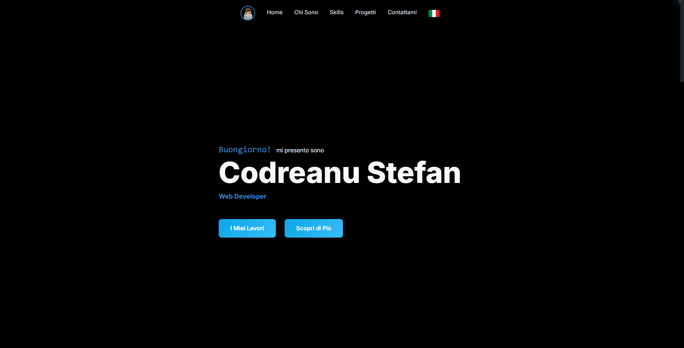

# Portfolio Website | [](#) + [](#) + [](#) + [](#)



A modern, high-performance **Portfolio website** built with **React**, **JavaScript** and  **GSAP**.

> ## [Click here for Live Preview!](https://scodreanu-portfolio.vercel.app/)

---

## ✨ Highlights

- Smooth animations with **GSAP**
- Modern **React (Vite) + JavaScript** codebase
- Fast, responsive UI (desktop + mobile)

---

## 🧰 Tech Stack

[](#)

[](#)

[](#)

[](#)

---

## 🚀 Getting Started

### 1) Clone

```bash
git clone https://github.com/SCodreanu/SCodreanu-Portfolio.git
cd SCodreanu-Portfolio
```

### 2) Install

```bash
npm install
```

### 3) Run locally

```bash
npm run dev
```

### 4) Build

```bash
npm run build
```

---

## 🧩 Customize (Quick Guide)

Typical things you’ll want to update:

- **Your name + hero section text**
- **Projects list**
- **Social links** (GitHub, LinkedIn, email)
- **SEO meta title/description**

---

## ⭐ Support

If you found this useful:

- Please **star** the repository (it helps a lot)
- Share it with a friend who needs a portfolio template
- Sponsor via the **Sponsor** button on GitHub (if available in your region)

---

## 🤝 Connect

- [](https://www.linkedin.com/in/stefan-codreanu-000380366/)

- [](https://github.com/SCodreanu)

---

## 🏷️ Recommended GitHub Topics (add in repo settings)

Add these topics to improve GitHub search visibility:

`portfolio` `developer-portfolio` `portfolio-website` `portfolio-template` `react` `javascript` `gsap` `frontend` `vite`

---

## 📃 License

